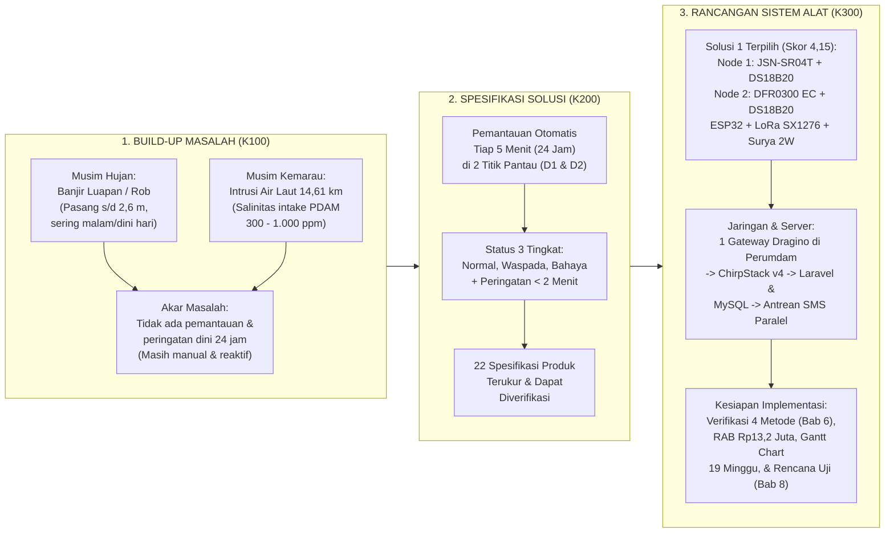

# Manual Gantt Chart Excel, Perhitungan Teknis K300, & Naskah Pemaparan Terpadu (K100 – K200 – K300)
**Kelompok 4 — Program Studi Rekayasa Sistem Komputer, Universitas Tanjungpura**
- **Anggota 1:** Muhammad Hisyam Faturrahman (`H1051231002`) — *Jaringan, Server, & Keamanan*
- **Anggota 2:** Helena Lia (`H1051231094`) — *Aplikasi Web Laravel & Basis Data MySQL*
- **Anggota 3:** George Junifer Gloria Nur's (`H1051231048`) — *Perangkat Keras & Firmware ESP32*
- **Pembimbing I:** Irma Nirmala, S.T., M.T. (`NIP. 198404052019032015`)
- **Pembimbing II:** Hirzen Hasfani, S.Kom., M.Cs. (`NIP. 199305032022031003`)

---

## Daftar Berkas yang Telah Dibuat di Folder Proyek

1. **[Gambar 7.1 Gantt chart.png](file:///d:/Perkuliahan/Semester%207/Capstone%20Design/Gambar%207.1%20Gantt%20chart.png)** — Gambar PNG beresolusi tinggi hasil konversi persis dari tabel di berkas [Gambar 7.1 Gantt chart.xlsx](file:///d:/Perkuliahan/Semester%207/Capstone%20Design/Gambar%207.1%20Gantt%20chart.xlsx) (`B2:W19`).
2. **[Gambar 7.1 Gantt chart (Standar Dokumen K300).png](file:///d:/Perkuliahan/Semester%207/Capstone%20Design/Gambar%207.1%20Gantt%20chart%20(Standar%20Dokumen%20K300).png)** — Gambar PNG beresolusi tinggi dengan gaya visual laporan K300 lengkap dengan legenda nama lengkap anggota dan kolom Minggu ke-1 s/d 19.
3. **[Master_K300_GanttChart_Perhitungan_Kelompok4.xlsx](file:///d:/Perkuliahan/Semester%207/Capstone%20Design/Master_K300_GanttChart_Perhitungan_Kelompok4.xlsx)** — Buku kerja Excel Master (6 Sheet) berisi Gantt Chart otomatis dengan rumus & *Conditional Formatting*, perhitungan matriks pemilihan alternatif solusi (`SUMPRODUCT` & uji sensitivitas), kalkulator rumus sensor & *power budget* baterai 48 jam, RAB Tabel 7.2, dan matriks keterunutan 22 spesifikasi K200 ke K300.

````carousel

<!-- slide -->

````

---

## BAGIAN 1: Manual Lengkap Cara Membuat & Mengimplementasikan Gantt Chart (Gambar 7.1) di Microsoft Excel

Terdapat **dua cara** pembuatan Gantt Chart di Excel yang telah diimplementasikan pada berkas [Gambar 7.1 Gantt chart.xlsx](file:///d:/Perkuliahan/Semester%207/Capstone%20Design/Gambar%207.1%20Gantt%20chart.xlsx) dan [Master_K300_GanttChart_Perhitungan_Kelompok4.xlsx](file:///d:/Perkuliahan/Semester%207/Capstone%20Design/Master_K300_GanttChart_Perhitungan_Kelompok4.xlsx):

### Metode 1: Cara Manual (Pewarnaan Sel Langsung seperti pada `Gambar 7.1 Gantt chart.xlsx`)
1. **Membuat Judul & Header Tabel (`B2:W4`):**
   - Blok sel `B2:W2`, klik **Home $\rightarrow$ Merge & Center**, ketik `Gantt Chart`.
   - Blok `B3:B4` (*Merge & Center*) ketik `No`; blok `C3:C4` ketik `Pekerjaan`; blok `D3:D4` ketik `Prasyarat`; blok `E3:E4` ketik `PJ`.
   - Blok `F3:W3` (*Merge & Center*) ketik `Minggu ke-`.
   - Pada baris `F4` sampai `W4` (atau `X4` untuk 19 minggu), ketik angka `1`, `2`, `3`, ..., `18` (atau `19`). Kecilkan lebar kolom `F` sampai `W` menjadi sekitar `6.8` (atau `45 piksel`) agar berbentuk kotak rapi.
2. **Mengisi 13 Baris Pekerjaan (`B5:E17`):**
   - Masukkan nomor `1` s/d `13`, nama pekerjaan, nomor prasyarat (untuk tanda strip `-` atau angka berformat teks seperti `1, 2` dan `5, 6, 7`, awali dengan tanda kutip tunggal `'-` atau `="5, 6, 7"` agar tidak dianggap tanggal/angka desimal oleh Excel), serta nama `PJ` (`Semua`, `Hisyam`, `Helena`, `George`).
   - Beri bingkai (*All Borders*) pada seluruh tabel `B2:W17`.
3. **Mewarnai Batang Jadwal Berdasarkan PJ:**
   - Blok sel minggu yang sesuai pada tiap baris pekerjaan, lalu klik **Home $\rightarrow$ Fill Color** sesuai warna penanggung jawab:
     - **Semua (Abu-abu `#AEAEAE` / `#7F7F7F`):** Pekerjaan 1 (`F5:G5`), Pekerjaan 2 (`F6:G6`), Pekerjaan 9 (`N13:O13`), Pekerjaan 10 (`P14:Q14`), Pekerjaan 11 (`R15`), Pekerjaan 12 (`S16:W16`), Pekerjaan 13 (`W17`).
     - **Hisyam (Biru `#A1BFCD` / `#2E75B6`):** Pekerjaan 3 (`H7:I7`), Pekerjaan 5 (`H9:I9`).
     - **George (Merah/Oranye `#FF7474` / `#C55A11`):** Pekerjaan 4 (`H8:I8`), Pekerjaan 6 (`J10:L10` atau `J10:M10` untuk Minggu 5–8), Pekerjaan 8 (`L12:M12`).
     - **Helena (Hijau `#A3C4A7` / `#548235`):** Pekerjaan 7 (`H11:M11`, Minggu 3–8).
4. **Membuat Keterangan Legenda (`D19:H19`):**
   - Ketik `Keterangan:` di `D19`, lalu warnai `E19` (`Hisyam` - Biru), `F19` (`Helena` - Hijau), `G19` (`George` - Merah), dan `H19` (`Semua` - Abu-abu).

---

### Metode 2: Cara Otomatis dengan Rumus Excel & *Conditional Formatting* (Pada Sheet `01_GANTT_CHART_K300` di File Master)
Metode ini jauh lebih unggul saat presentasi/sidang karena apabila Dosen Penguji meminta simulasi perubahan jadwal, batang warna akan **bergeser dan berubah warna secara otomatis**:

1. **Tambahkan Kolom `Minggu Mulai` (Kolom E), `Minggu Selesai` (Kolom F), dan `Durasi` (Kolom G):**
   - Pada sel `G8` (Durasi), masukkan rumus:
     ```excel
     =F8-E8+1
     ```
2. **Masukkan Rumus Otomatis pada Area Kalender Minggu (`H8:Z20`):**
   - Pada sel `H8` (baris Pekerjaan 1, kolom Minggu ke-1), masukkan rumus:
     ```excel
     =IF(AND(H$7>=$E8, H$7<=$F8), "■", "")
     ```
     *(Catatan: Jika pengaturan regional Excel menggunakan Bahasa Indonesia, ganti koma `,` dengan titik koma `;` menjadi `=IF(AND(H$7>=$E8; H$7<=$F8); "■"; "")`).*
   - **Cara kerja rumus:**
     - `H$7` membaca angka minggu pada baris header (baris 7 dikunci dengan `$` agar saat ditarik ke bawah tetap mengacu ke baris 7).
     - `$E8` dan `$F8` membaca `Minggu Mulai` dan `Minggu Selesai` pada baris pekerjaan tersebut (kolom E dan F dikunci dengan `$` agar saat ditarik ke kanan tetap mengacu ke kolom E dan F).
     - `AND(H$7>=$E8, H$7<=$F8)` bernilai `TRUE` jika angka minggu berada di antara Minggu Mulai dan Minggu Selesai.
3. **Pasang 4 Aturan *Conditional Formatting* untuk Pewarnaan Otomatis per PJ:**
   - Blok seluruh area matriks minggu (`H8:Z20`), klik **Home $\rightarrow$ Conditional Formatting $\rightarrow$ New Rule $\rightarrow$ Use a formula to determine which cells to format**, lalu masukkan 4 rumus berikut:
     - **Aturan 1 (Biru – Hisyam):**
       ```excel
       =AND(H$7>=$E8, H$7<=$F8, $D8="Hisyam")
       ```
     - **Aturan 2 (Hijau – Helena):**
       ```excel
       =AND(H$7>=$E8, H$7<=$F8, $D8="Helena")
       ```
     - **Aturan 3 (Merah/Oranye – George):**
       ```excel
       =AND(H$7>=$E8, H$7<=$F8, $D8="George")
       ```
     - **Aturan 4 (Abu-abu – Semua):**
       ```excel
       =AND(H$7>=$E8, H$7<=$F8, $D8="Semua")
       ```
4. **Rekapitulasi Beban Kerja Otomatis per Anggota (`COUNTIF` & `SUMIF`):**
   - Menghitung jumlah paket pekerjaan per PJ:
     ```excel
     =COUNTIF($D$8:$D$20, "Hisyam")
     ```
   - Menghitung total minggu-orang (*person-weeks*) per PJ:
     ```excel
     =SUMIF($D$8:$D$20, "Hisyam", $G$8:$G$20)
     ```

> [!TIP]
> **Catatan Penting untuk Sidang/Presentasi Terkait Gambar 7.1:**
> Pada teks dokumen K300 Bagian 7.3 (halaman 38) dan Bagian 9 (halaman 46) tertulis bahwa jadwal implementasi direncanakan selama **19 minggu** (di mana Pekerjaan 12 *Uji lapangan 7 hari dan pemantauan 30 hari* berlangsung selama 5 minggu dari Minggu ke-14 s/d 18, dilanjutkan Pekerjaan 13 *Evaluasi dan penyusunan laporan* hingga Minggu ke-19). Pada `Gambar 7.1 Gantt chart.xlsx` kolom angka tertulis sampai `18` (dengan Evaluasi di Minggu ke-18). Kami telah menyediakan **kedua versi gambar PNG** (versi 18 minggu persis file Excel dan versi 19 minggu sesuai teks K300) agar kelompok siap menjawab apabila dosen menanyakan detail tersebut.

---

## BAGIAN 2: Penjelasan Perhitungan Pemilihan Alternatif Solusi (Bab 2 K300)

Pada **Bab 2 Dokumen K300**, pemilihan solusi dilakukan untuk memenuhi 22 spesifikasi pada K200 dengan membandingkan **3 Alternatif Solusi** yang berbeda secara signifikan pada **cara mengukur tinggi muka air** dan **cara mengirim data**:

| Karakteristik | Alternatif Solusi 1 *(Terpilih)* | Alternatif Solusi 2 | Alternatif Solusi 3 |
| :--- | :--- | :--- | :--- |
| **Sensor Tinggi Muka Air** | **Sensor Ultrasonik Tahan Air (`JSN-SR04T`)** dipasang di atas permukaan air ($\ge 4,25\text{ m}$ di atas titik nol) + Sensor Suhu Udara `DS18B20` | **Sensor Tekanan Celup (*Submersible Pressure*)** diletakkan di dalam air pada kedalaman tetap | **Kamera + Komputer Mini (*Computer Vision*)** membaca papan duga air berskala + lampu sorot malam |
| **Sensor Kadar Garam** | Sensor Konduktivitas `DFR0300` ($K=1$) + Suhu Air `DS18B20` | Sensor Konduktivitas `DFR0300` ($K=1$) + Suhu Air `DS18B20` | Sensor Konduktivitas `DFR0300` ($K=1$) + Suhu Air `DS18B20` |
| **Jaringan Komunikasi** | **LoRaWAN (`SX1276` 920–923 MHz)** ke 1 Gateway `Dragino LPS8N` di fasilitas Perumdam | **Modem Seluler 4G** langsung di setiap titik pantau tanpa gateway perantara | **Modem Seluler 4G** mengirim angka hasil olah citra beserta foto ukuran kecil |
| **Konsumsi Energi Harian** | **$\approx 0,4\text{ Wh/hari}$** per titik pantau *(Sangat Hemat)* | **$\approx 2,5\text{ Wh/hari}$** per titik pantau *(Arus pancar 4G besar)* | **$\approx 105\text{ Wh/hari}$** per titik pantau *(Komputer & lampu menyala terus)* |

### 1. Rumus Matriks Keputusan Berbobot (*Weighted Decision Matrix*) — Persamaan (2.1)
Nilai total setiap alternatif dihitung menggunakan **Persamaan (2.1)** pada halaman 8 K300:

$$NT = \sum_{i=1}^{7} (w_i \times n_i)$$

Di mana:
- $NT$ = Nilai Total alternatif solusi
- $w_i$ = Bobot kepentingan kriteria ke-$i$ (total $\sum w_i = 100\% = 1,00$)
- $n_i$ = Skor alternatif pada kriteria ke-$i$ (skala $1$ sampai $5$)

### 2. Rincian Perhitungan Tabel 2.1 Perbandingan Alternatif Solusi
Di Excel (Sheet `02_ALTERNATIF_SOLUSI_K300`), perhitungan dilakukan otomatis dengan rumus `=SUMPRODUCT($D$12:$D$18, E12:E18)`:

| No | Kriteria Penilaian | Spesifikasi K200 | Bobot ($w_i$) | Solusi 1 ($n_{1i}$) | $w_i \times n_{1i}$ | Solusi 2 ($n_{2i}$) | $w_i \times n_{2i}$ | Solusi 3 ($n_{3i}$) | $w_i \times n_{3i}$ |
| :-: | :--- | :-: | :-: | :-: | :-: | :-: | :-: | :-: | :-: |
| 1 | Ketelitian pengukuran | 2, 4 | $20\%$ ($0,20$) | $4$ | $0,80$ | $4$ | $0,80$ | $2$ | $0,40$ |
| 2 | Ketahanan daya | 11 | $20\%$ ($0,20$) | $5$ | $1,00$ | $3$ | $0,60$ | $1$ | $0,20$ |
| 3 | Keandalan pengiriman data | 5, 6, 7, 13 | $15\%$ ($0,15$) | $3$ | $0,45$ | $4$ | $0,60$ | $3$ | $0,45$ |
| 4 | Ketahanan lingkungan & perawatan | 12, 14 | $15\%$ ($0,15$) | $4$ | $0,60$ | $2$ | $0,30$ | $3$ | $0,45$ |
| 5 | Biaya pengadaan | – | $10\%$ ($0,10$) | $4$ | $0,40$ | $3$ | $0,30$ | $1$ | $0,10$ |
| 6 | Biaya operasional bulanan | – | $10\%$ ($0,10$) | $5$ | $0,50$ | $3$ | $0,30$ | $2$ | $0,20$ |
| 7 | Kemudahan pemasangan | 18 | $10\%$ ($0,10$) | $4$ | $0,40$ | $3$ | $0,30$ | $2$ | $0,20$ |
| **Total** | **Nilai Total ($NT$)** | | **$100\%$ ($1,00$)** | | **$4,15$** | | **$3,20$** | | **$2,00$** |

- **Perhitungan Manual Alternatif Solusi 1:**
  $$NT_1 = (0,20 \times 4) + (0,20 \times 5) + (0,15 \times 3) + (0,15 \times 4) + (0,10 \times 4) + (0,10 \times 5) + (0,10 \times 4) = 0,80 + 1,00 + 0,45 + 0,60 + 0,40 + 0,50 + 0,40 = \mathbf{4,15}$$
- **Perhitungan Manual Alternatif Solusi 2:**
  $$NT_2 = (0,20 \times 4) + (0,20 \times 3) + (0,15 \times 4) + (0,15 \times 2) + (0,10 \times 3) + (0,10 \times 3) + (0,10 \times 3) = 0,80 + 0,60 + 0,60 + 0,30 + 0,30 + 0,30 + 0,30 = \mathbf{3,20}$$
- **Perhitungan Manual Alternatif Solusi 3:**
  $$NT_3 = (0,20 \times 2) + (0,20 \times 1) + (0,15 \times 3) + (0,15 \times 3) + (0,10 \times 1) + (0,10 \times 2) + (0,10 \times 2) = 0,40 + 0,20 + 0,45 + 0,45 + 0,10 + 0,20 + 0,20 = \mathbf{2,00}$$

### 3. Uji Sensitivitas Bobot (*Sensitivity Analysis* — Halaman 9–10 K300)
Untuk membuktikan bahwa terpilihnya Solusi 1 tidak disebabkan oleh subjektivitas pemberian bobot, dilakukan pengujian kondisi paling menguntungkan bagi Solusi 2, yaitu **menurunkan bobot Ketahanan Daya dari $20\%$ menjadi $10\%$** dan **menaikkan bobot Keandalan Pengiriman Data dari $15\%$ menjadi $25\%$**:
- $NT_{1,\text{uji}} = (0,20 \times 4) + (0,10 \times 5) + (0,25 \times 3) + (0,15 \times 4) + (0,10 \times 4) + (0,10 \times 5) + (0,10 \times 4) = \mathbf{3,95}$
- $NT_{2,\text{uji}} = (0,20 \times 4) + (0,10 \times 3) + (0,25 \times 4) + (0,15 \times 2) + (0,10 \times 3) + (0,10 \times 3) + (0,10 \times 3) = \mathbf{3,30}$
- $NT_{3,\text{uji}} = (0,20 \times 2) + (0,10 \times 1) + (0,25 \times 3) + (0,15 \times 3) + (0,10 \times 1) + (0,10 \times 2) + (0,10 \times 2) = \mathbf{2,20}$
- **Kesimpulan:** Solusi 1 tetap unggul jauh ($3,95 > 3,30 > 2,20$).

---

## BAGIAN 3: Penjelasan Seluruh Perhitungan Teknis Sistem Alat pada K300

Seluruh perhitungan di bawah ini telah dibuatkan kalkulator interaktifnya pada **Sheet `03_PERHITUNGAN_TEKNIS_ALAT`** dan **Sheet `04_ESTIMASI_BIAYA_RAB_K300`**:

### 1. Perhitungan Tinggi Muka Air & Koreksi Suhu Udara (Titik Pantau 1 — Persamaan 4.1, 4.2, 4.3)
- **Penyaringan Nilai Tengah (*Median Filter*):** Mikrokontroler mengambil 5 pembacaan waktu pantul gelombang ultrasonik ($t_1, t_2, t_3, t_4, t_5$) dengan jeda $200\text{ ms}$, membuang bacaan di luar rentang $25\text{–}450\text{ cm}$, lalu mengambil nilai tengahnya (`=MEDIAN(t1:t5)`) agar kebal terhadap gangguan sesaat seperti cipratan air atau sampah terapung.
- **Koreksi Kecepatan Suara terhadap Suhu Udara ($T$ dalam $^\circ\text{C}$ dari sensor `DS18B20`):**
  $$c = 331,3 + 0,606 \times T \quad (\text{m/s}) \quad \text{[Persamaan 4.1]}$$
- **Perhitungan Jarak Sensor ke Permukaan Air ($d$):**
  $$d = \frac{c \times t}{2} \quad (\text{m}) \quad \text{[Persamaan 4.2]}$$
- **Perhitungan Tinggi Muka Air terhadap Titik Nol ($H$):**
  $$H = H_s - d \quad (\text{m}) \quad \text{[Persamaan 4.3]}$$
  *(Dengan $H_s \ge 4,25\text{ m}$ agar saat muka air mencapai batas atas $H = 4,00\text{ m}$, jarak $d = 4,25 - 4,00 = 0,25\text{ m} = 25\text{ cm}$ masih di atas jarak buta minimum sensor `JSN-SR04T` sebesar $25\text{ cm}$).*
- **Mengapa Koreksi Suhu Wajib Digunakan?**
  Lembar data sensor memakai kecepatan suara tetap $340\text{ m/s}$ (setara suhu $\approx 14,4^\circ\text{C}$). Di Pontianak ketika suhu udara siang hari mencapai $32^\circ\text{C}$, kecepatan suara sebenarnya adalah $c = 331,3 + 0,606(32) = 350,69\text{ m/s}$. Selisih suhu sebesar $5^\circ\text{C}$ saja pada jarak $4,25\text{ m}$ sudah menimbulkan kesalahan sekitar **$4\text{ cm}$**, yang melanggar batas spesifikasi K200 Nomor 4 ($\le \pm 2\text{ cm}$). Dengan koreksi suhu `DS18B20` ($\pm 0,5^\circ\text{C}$), galat ditekan di bawah $\pm 2\text{ cm}$.

### 2. Perhitungan Kadar Garam / Salinitas & Kompensasi Suhu Air (Titik Pantau 2 — Persamaan 4.4 & 4.5)
- **Kompensasi Daya Hantar Listrik ($EC$) ke Suhu Acuan $25^\circ\text{C}$:**
  Daya hantar listrik air meningkat sekitar $\alpha = 2\%\text{ per }^\circ\text{C}$ ($0,02/^\circ\text{C}$). Oleh karena itu, nilai $EC$ mentah ($\mu\text{S/cm}$) dari sensor `DFR0300` dinormalkan ke suhu $25^\circ\text{C}$ menggunakan suhu air $T$ dari sensor `DS18B20`:
  $$EC_{25} = \frac{EC}{1 + \alpha \times (T - 25)} \quad (\mu\text{S/cm}) \quad \text{[Persamaan 4.4]}$$
- **Konversi $EC_{25}$ Menjadi Kadar Garam sebagai TDS ($\text{ppm}$):**
  $$\text{ppm} = k \times EC_{25} \quad (\text{ppm}) \quad \text{[Persamaan 4.5]}$$
  Dengan faktor konversi awal $k = 0,5$ dan kalibrasi dua titik menggunakan larutan standar $1.413\ \mu\text{S/cm}$ serta $12,88\text{ mS/cm}$ ($12.880\ \mu\text{S/cm}$).
  - *Contoh Perhitungan:* Saat suhu air sungai $T = 29^\circ\text{C}$ dan bacaan mentah $EC = 648\ \mu\text{S/cm}$:
    $$EC_{25} = \frac{648}{1 + 0,02 \times (29 - 25)} = \frac{648}{1,08} = 600\ \mu\text{S/cm} \implies \text{ppm} = 0,5 \times 600 = \mathbf{300\text{ ppm}}$$

### 3. Kriteria Ambang Batas Status Sungai & Logika Histeresis (Tabel 4.4 K300)
- **Tinggi Muka Air ($H$), dengan $H_b$ = Tinggi bibir sungai / jalan terendah permukiman:**
  - **Normal (Hijau):** $H < H_b - 30\text{ cm}$
  - **Waspada (Kuning):** $H_b - 30\text{ cm} \le H < H_b$
  - **Bahaya (Merah):** $H \ge H_b$
  - **Histeresis Turun Status:** $5\text{ cm}$ selama **3 data berturut-turut ($15\text{ menit}$)** (status dari Bahaya baru turun ke Waspada jika 3 bacaan berturut-turut $< H_b - 5\text{ cm}$; dari Waspada baru turun ke Normal jika 3 bacaan berturut-turut $< H_b - 35\text{ cm}$).
- **Kadar Garam sebagai TDS ($S$):**
  - **Normal (Hijau):** $S < 200\text{ ppm}$
  - **Waspada (Kuning):** $200\text{ ppm} \le S < 300\text{ ppm}$
  - **Bahaya (Merah):** $S \ge 300\text{ ppm}$ *(Mengacu pada batas TDS air minum $< 300\text{ mg/L}$ sesuai Permenkes No. 2 Tahun 2023)*.
  - **Histeresis Turun Status:** $20\text{ ppm}$ selama **3 data berturut-turut ($15\text{ menit}$)** (dari Bahaya turun ke Waspada jika $< 280\text{ ppm}$; dari Waspada turun ke Normal jika $< 180\text{ ppm}$).
- **Deteksi Lonjakan Tidak Wajar (Anomali Sensor):**
  - Jika perubahan antar 2 siklus (selang 5 menit) $|\Delta H| > 30\text{ cm}$ atau $|\Delta S| > 500\text{ ppm}$, data ditandai `"perlu diperiksa"` dan sistem mengirim pemberitahuan `D6` ke petugas patroli.

### 4. Perhitungan Anggaran Energi (*Power Budget*) & Ketahanan Baterai 48 Jam
- **Jumlah Siklus Harian:** $\frac{24\text{ jam} \times 60\text{ menit}}{5\text{ menit}} = \mathbf{288\text{ siklus/hari}}$.
- **Kebutuhan Energi Harian per Titik Pantau:** Karena `ESP32` masuk ke *deep sleep* ($\approx 10\ \mu\text{A}$) dan sakelar `MOSFET` memutus catu daya sensor di antara pengukuran, energi harian secara konservatif hanya $\approx \mathbf{0,4\text{ Wh/hari}}$ (atau $\mathbf{0,8\text{ Wh}}$ untuk $48\text{ jam}$).
- **Kapasitas Baterai:** 2 buah baterai Li-ion `18650` @ $3.000\text{ mAh}$ ($3,7\text{ V}$) menyimpan energi:
  $$E_{\text{baterai}} = 2 \times 3,0\text{ Ah} \times 3,7\text{ V} = \mathbf{22,2\text{ Wh}} \quad (\approx 22\text{ Wh})$$
- **Ketahanan Tanpa Sinar Matahari:**
  - Setelah $48\text{ jam}$ tanpa matahari, energi yang terpakai hanya $0,8\text{ Wh}$, sehingga sisa baterai masih $\frac{22,2 - 0,8}{22,2} = \mathbf{96,4\%}$ (jauh di atas syarat kriteria keberhasilan Tabel 6.1 yaitu sisa baterai $\ge 20\%$).
  - Dengan batas pemakaian aman $80\%$ kapasitas ($17,76\text{ Wh}$ sebelum alarm baterai lemah $20\%$ aktif), titik pantau mampu bertahan:
    $$T_{\text{bertahan}} = \frac{17,76\text{ Wh}}{0,4\text{ Wh/hari}} = \mathbf{44,4\text{ hari}} \quad (> 40\text{ hari tanpa sinar matahari!})$$

### 5. Perhitungan Ukuran Paket Data Biner (13 Byte), Antrean 24 Jam, & Database 30 Hari
- **Susunan Paket 13 Byte (Tabel 4.2 K300):**
  - Byte `0`: Jenis node (`uint8`, 1 byte)
  - Byte `1–4`: Waktu ukur UTC (`uint32`, 4 byte)
  - Byte `5–6`: Nilai utama tinggi air mm / garam ppm (`uint16`, 2 byte)
  - Byte `7–8`: Suhu $0,01^\circ\text{C}$ (`int16`, 2 byte)
  - Byte `9`: Sisa baterai % (`uint8`, 1 byte)
  - Byte `10`: Tanda kondisi bit (`uint8`, 1 byte)
  - Byte `11–12`: Jumlah antrean (`uint16`, 2 byte)
  - **Total** = $1 + 4 + 2 + 2 + 1 + 1 + 2 = \mathbf{13\text{ byte}}$ (waktu pancar LoRa SF7–SF9 hanya $62\text{–}206\text{ ms} \le 400\text{ ms}$).
- **Antrean Memori Flash 24 Jam (Spesifikasi No. 13):**
  - $24\text{ jam} = \mathbf{288\text{ paket}} \times 13\text{ byte} = \mathbf{3.744\text{ byte}}$ ($\approx 3,66\text{ KB}$).
  - Saat jaringan pulih, setiap siklus (5 menit) dikirim maksimal 5 paket (1 paket baru + 4 paket antrean), sehingga antrean 24 jam terkirim tuntas dalam $\frac{288}{4} \times 5\text{ menit} = 360\text{ menit} = \mathbf{6\text{ jam}}$.
- **Kapasitas Basis Data 30 Hari (Spesifikasi No. 15):**
  - $2\text{ titik pantau} \times 288\text{ data/hari} \times 30\text{ hari} = \mathbf{17.280\text{ baris}}$ pada tabel `measurements`.
- **Target Lulus Uji Lapangan 7 Hari (Spesifikasi No. 5 & Tabel 8.1):**
  - $7\text{ hari} \times 288\text{ data/hari} = \mathbf{2.016\text{ data per titik pantau}}$. Syarat lulus $\ge 95\%$ berarti minimal $\lceil 0,95 \times 2.016 \rceil = \mathbf{1.916\text{ data}}$ harus tersimpan.

### 6. Perhitungan Estimasi Biaya Pengembangan (Tabel 7.2 K300)
- **Subtotal Pengadaan Perangkat Keras & Bahan (Item 1 s/d 14):** **$\text{Rp}10.523.800$** ($79,7\%$), dengan komponen terbesar Gerbang LoRaWAN `Dragino LPS8N AS923` seharga $\text{Rp}6.575.000$ ($49,8\%$).
- **Subtotal Biaya Operasional 6 Bulan Pertama (Item 15 s/d 17):** **$\text{Rp}2.680.000$** ($20,3\%$), terdiri dari Sewa VPS 6 bulan ($\text{Rp}1.920.000$), Kredit SMS Gateway 6 bulan ($\text{Rp}630.000$), dan Nama Domain 1 tahun ($\text{Rp}130.000$).
- **Total Estimasi Biaya Pengembangan:** **$\text{Rp}13.203.800$**.

---

## BAGIAN 4: Alur Pemaparan Solusi Terpadu (Compact Pitch: Build-Up K100 $\rightarrow$ Solusi K200 $\rightarrow$ Sistem Alat K300)

Bagian ini disusun sebagai **panduan alur presentasi yang padat (*compact*)** untuk menjelaskan kesinambungan masalah dari **K100**, dirumuskan menjadi spesifikasi di **K200**, hingga diselesaikan dengan perancangan alat di **K300**:



### Pembagian Alur Bicara Tim Saat Presentasi / Sidang:

1. **Bagian Pembuka — Build-Up Masalah dari K100 ke K200 (Disampaikan oleh Helena / Hisyam):**
   - *"Kota Pontianak berada di dataran rendah $0,1\text{–}1,5\text{ mdpl}$ di sekitar Sungai Kapuas Kecil dan menghadapi dua bencana hidrologi musiman yang berulang setiap tahun. Pada musim hujan, kenaikan pasang hingga $2,6\text{ meter}$ yang berpadu dengan hujan lebat memicu banjir luapan, terutama pada malam dan dini hari saat tidak ada pengamat. Sebaliknya pada musim kemarau, air laut menyusup hingga $14,61\text{ km}$ ke hulu dan membuat kadar garam di titik penyedotan air baku Perumdam Tirta Khatulistiwa melonjak hingga $300\text{–}1.000\text{ ppm}$, melewati batas layak air minum $300\text{ ppm}$."*
   - *"Akar masalah yang kami identifikasi pada **K100** adalah ketiadaan sistem pemantauan dan peringatan dini yang siaga 24 jam. Saat ini pembacaan papan duga air hanya dilakukan 3 kali sehari secara manual dan pengujian keasinan terbatas pada jam kerja. Oleh karena itu, pada **K200** kami merumuskan target sistem terintegrasi yang mengukur kedua parameter secara otomatis setiap **5 menit selama 24 jam** di dua titik pantau, lalu mengirimkan peringatan dini otomatis dalam waktu **kurang dari 2 menit** kepada **4 entitas pengguna** (Masyarakat, Operator Perumdam, Petugas Patroli, dan Administrator). Kebutuhan tersebut diturunkan menjadi **22 butir spesifikasi produk**."*

2. **Bagian Inti 1 — Pemilihan Alternatif Solusi & Perangkat Keras pada K300 (Disampaikan oleh George):**
   - *"Untuk memenuhi ke-22 spesifikasi K200 tersebut, pada **Bab 2 K300** kami membandingkan tiga alternatif solusi menggunakan 7 kriteria berbobot. **Alternatif Solusi 1** (Sensor Ultrasonik `JSN-SR04T` + Konduktivitas `DFR0300` berbasis `ESP32` dan komunikasi `LoRaWAN`) terpilih dengan skor tertinggi **4,15**, mengungguli Solusi 2 (Sensor Tekanan Celup + 4G, skor **3,20**) dan Solusi 3 (Kamera *Computer Vision* + 4G, skor **2,00**), bahkan setelah diuji sensitivitas bobotnya."*
   - *"Keunggulan utama Solusi 1 terletak pada algoritma pengukurannya dan efisiensi energinya. Di Titik Pantau 1, sensor ultrasonik dipasang minimal $4,25\text{ m}$ di atas titik nol, disaring dengan **filter median 5 pembacaan**, dan dikoreksi kecepatannya terhadap suhu udara dengan sensor `DS18B20` ($c = 331,3 + 0,606T$) agar memenuhi batas ketelitian $\le \pm 2\text{ cm}$. Di Titik Pantau 2, daya hantar listrik air dikompensasi ke suhu $25^\circ\text{C}$ sebelum dikonversi menjadi $\text{ppm}$ TDS. Dengan mode *deep sleep* `ESP32` ($10\ \mu\text{A}$) dan pemutus daya `MOSFET`, konsumsi energi harian hanya **$0,4\text{ Wh/hari}$**, sehingga 2 baterai `18650` ($22\text{ Wh}$) mampu bertahan lebih dari **40 hari tanpa sinar matahari**—jauh melampaui syarat spesifikasi 48 jam."*

3. **Bagian Inti 2 — Arsitektur Jaringan LoRaWAN, Server Laravel, & Keamanan (Disampaikan oleh Hisyam & Helena):**
   - *"Data dari kedua titik pantau dikemas dalam paket biner ringkas berukuran **13 byte** dan dikirim setiap 5 menit melalui jaringan **LoRaWAN AS923-2 (920–923 MHz)** dengan waktu pancar hanya $62\text{–}206\text{ ms}$ menuju 1 Gateway `Dragino LPS8N` di fasilitas Perumdam. Apabila komunikasi terputus, titik pantau menyimpan antrean sedikitnya **288 paket (24 jam)** di memori flash dan mengirimkannya ulang otomatis saat jaringan pulih."*
   - *"Di pusat pengolahan data (VPS), `ChirpStack v4` meneruskan data ke aplikasi monolitik **Laravel** dan basis data **MySQL** (10 tabel, menyimpan $\ge 17.280$ baris per 30 hari). Penentuan status **Normal (Hijau)**, **Waspada (Kuning)**, dan **Bahaya (Merah)** dilengkapi **logika histeresis 3 siklus (15 menit)** agar warga tidak menerima SMS berulang saat nilai berosilasi di sekitar ambang batas ($300\text{ ppm}$ untuk garam dan $H_b$ untuk tinggi air). Pengiriman SMS dijalankan melalui **antrean pekerja paralel (*Queue Worker*)** sehingga peringatan ke 20 nomor selesai di bawah 2 menit."*

4. **Bagian Penutup — Verifikasi, Estimasi Biaya (RAB), Gantt Chart, & Rencana Pengujian (Disampaikan Bersama):**
   - *"Seluruh 22 spesifikasi K200 telah tertelusur 100% pada Tabel 5.1 K300, diverifikasi kelayakannya melalui 4 metode pemodelan dan simulasi pada Bab 6 (perhitungan anggaran energi, *link budget* LoRa, simulasi Wokwi, dan simulasi server + k6 + Wireshark). Untuk tahap implementasi lanjutan, dibutuhkan total biaya **Rp13.203.800** (pengadaan Rp10.523.800 dan operasional 6 bulan Rp2.680.000) dengan jadwal pelaksanaan selama **19 minggu** sebagaimana dipetakan pada **Gambar 7.1 Gantt Chart** dan diuji melalui 5 metode pengujian pada Bab 8."*
